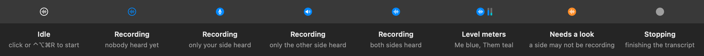

# Feedback Recorder

A macOS menu bar app that turns a software review call into a timestamped transcript with screenshots. Record both sides, copy images as you talk, then hand the session to **Codex or Claude Code** to work through the feedback.



## What it does

- Captures microphone and system audio as separate tracks, or one microphone track in room mode.
- Transcribes on-device with Apple's Speech framework while recording.
- Files newly copied PNG/TIFF images alongside the transcript, with timestamps.
- Shows which channels have been heard and warns about missing audio or transcription.
- Saves plain Markdown, audio, screenshots and JSON in a session folder.
- Includes one portable feedback skill for Codex and Claude Code. It lists proposed changes before implementing the items you select.

The app records and transcribes locally. **Using the optional AI skill can send transcripts and images to the coding agent's configured service.** See [Privacy](docs/privacy.md) for the full boundary.

## Requirements and install

macOS 26 or later, Xcode Command Line Tools, and Python 3 for the optional skill. No coding agent is needed to record or read the output.

```sh
git clone https://github.com/kmpflr/feedback-recorder.git
cd feedback-recorder
scripts/make-cert.sh       # once: create a local signing identity
scripts/install-app.sh     # build, sign, install and launch
```

The signing script creates a self-signed code-signing certificate in your login keychain and asks macOS to trust it, potentially prompting for your login password. The stable identity helps preserve recording permissions across rebuilds. These source builds are not notarized distributions.

At first launch, the app requests microphone, system-audio recording and notification permissions. macOS may download the on-device speech assets. Allow microphone access and system audio for two-track calls; notifications explain recording failures but are not required for capture.

## Record a review

1. **Start:** click the icon or press ⌃⌥⌘R. Check the notification's input device and capture mode.
2. **Talk:** copy a screenshot with ⌘⌃⇧4. Newly copied PNG/TIFF images are collected while recording, including images copied from other apps.
3. **Stop:** press the hotkey, or click the icon and choose Stop. A plain click during recording opens the menu, so stopping takes a deliberate choice.
4. **Use the result:** open the session folder or paste the copied feedback command into your selected coding agent's chat in the repository you want to change.

Right-click, Control-click or Command-click the icon for the menu. It opens at the pointer on the display you clicked. The **Input** submenu can switch microphones during recording without creating a new session. If the new device fails, capture falls back to the previous input.

For a speakerphone or an in-person review, turn off **Capture system audio**. Room mode records one microphone track labelled `Room`. Obtain participants' agreement before recording and keep unrelated private content off the clipboard.

## Connect your coding agent

Install the skill for either agent, or both:

```sh
scripts/install-skill.sh codex
scripts/install-skill.sh claude-code
scripts/install-skill.sh both
```

| Agent | Installed folder | Paste into the agent's chat |
| --- | --- | --- |
| Codex | `~/.agents/skills/feedback/` | `$feedback /absolute/path/to/session` |
| Claude Code | `~/.claude/skills/feedback/` | `/feedback /absolute/path/to/session` |

Choose **Feedback agent → Codex / Claude Code** in the app menu. **Copy feedback command** and the automatic copy after stopping use that selection. Existing installations default to Claude Code. Codex uses `$feedback`; `/feedback` is a separate built-in Codex command and should not be used to invoke this skill.

Both agents use the same `SKILL.md` and helper. Open the agent in the project you want to change, with access to the local session folder. The skill lists requests with timestamps and screenshots, marks unclear requests as questions, and implements the items you select. It records what it covered in `feedback-items.md`, so you can run it mid-call and again later. If a newly installed skill does not appear, restart the agent.

For a project-scoped installation, supply a destination:

```sh
scripts/install-skill.sh codex --dest /path/to/project/.agents/skills/feedback
```

See the [synthetic walkthrough](docs/demo.md), which can be tried without recording or sharing real conversations. Codex installation follows the [official skills documentation](https://learn.chatgpt.com/docs/build-skills).

## Understand the menu bar

| State | Meaning |
| --- | --- |
| Outlined waveform | Recording; neither channel has been heard yet |
| Microphone | Only the microphone channel has been heard |
| Speaker | Only system audio has been heard |
| Filled waveform | Both channels have been heard |
| Orange | A channel needs attention; the menu and notification explain why |
| Grey stop | Finalizing transcription and audio |

A transcript line marks a channel as heard. When transcription is unavailable, several speech-shaped audio bursts can also count; a continuous chime alone does not. Call mode warns if one side remains unheard while the other has carried enough conversation. Room mode deliberately has only one channel. Channel labels describe capture sources, not verified speaker identities.

Level meters are blue for the microphone and teal for system audio, measured relative to each channel's noise floor. Orange bars indicate a channel warning.

## Session files and transcription recovery

The default location is `~/FeedbackSessions/<yyyy-MM-dd_HHmm>/`. A session contains:

```text
transcript.md       timestamped conversation, image links and capture notes
shots/001.png       images copied during recording
audio/me.m4a        microphone track after a clean stop
audio/them.m4a      system-audio track after a clean stop
session.json        capture configuration, heard channels, counts and stop reason
vocab.txt           vocabulary copied when the session started
```

Audio is WAV during recording, converted to AAC after stopping. Room mode writes `audio/room.m4a`. Interrupted sessions are marked as crashed on the next launch, with WAVs retained for recovery. Failed writes can still lose data; this is not a backup system.

An optional local `whisper-cli` can reread detected transcription gaps after stopping. The app does not install or download it or its model. Set explicit paths if using it:

```sh
defaults write local.feedback-recorder whisperExecutable /absolute/path/to/whisper-cli
defaults write local.feedback-recorder whisperModel /absolute/path/to/local-model.bin
```

Without those dependencies, a note explains that gap recovery was unavailable and the existing recording remains. Recovery can delay finalization; recovered turns are annotated with the engine that produced them.

## Settings

| Setting | Default | Purpose |
| --- | --- | --- |
| Input | System default | Microphone to capture |
| Capture system audio | On | Off selects room mode |
| Feedback agent | Claude Code | Command syntax copied for Codex or Claude Code |
| Level meters | On | Show per-channel input levels |
| Silence auto-stop | 10 minutes | Stop after prolonged silence |
| One-sided silence warning | 3 minutes | Warn about a missing or silent side of a call |
| Session root | `~/FeedbackSessions` | Folder where sessions are saved |

Vocabulary is stored at `~/Library/Application Support/FeedbackRecorder/vocab.txt`, up to 100 phrases, one per line. The on-device recognizer receives contextual strings; the skill also uses the session's vocabulary copy to resolve clear mis-hearings. Neither guarantees correct transcription. The shipped vocabulary contains synthetic examples to replace.

The hotkey can be changed with `hotkeyKeyCode` and `hotkeyModifiers` defaults under `local.feedback-recorder`, then restarting the app.

## Develop

```sh
scripts/test.sh
python3 -m unittest discover -s skill/tests -v
python3 -m unittest discover -s scripts/tests -v
swift build -c release
python3 scripts/check-publication.py
```

[Architecture and tradeoffs](docs/architecture.md) explains the core/adapters split. [Known issues](docs/known-issues.md) lists practical limits. Run the [manual checks](docs/manual-check.md) after changing capture or menu behavior; unit tests do not exercise actual microphones or multiple displays. CI builds and tests on macOS and scans for accidental credentials.

AI coding assistance was used during development. This repository's examples and demo are synthetic; no real meeting recordings are included.

## License

[PolyForm Noncommercial 1.0.0](LICENSE.md), retaining the project's chosen license. See [CONTRIBUTING.md](CONTRIBUTING.md) for contribution terms.
