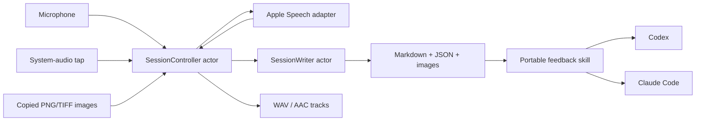

# Architecture and tradeoffs

The SwiftPM package separates a testable `FeedbackCore` library from an AppKit executable with platform adapters. The Python helper and Markdown skill consume session files independently of either coding agent.

## Capture and timing

`AudioSource` adapters stream timestamped buffers. Per-channel clocks align them with the session timeline. Format conversion is streaming, including its tail at shutdown. Audio levels and disk writes are handled before buffers reach the transcriber, which may consume them.

Microphone and system audio remain separate capture channels. This avoids requiring live diarization, but `Me` and `Them` do not prove speaker identity: a microphone can pick up several people. Room mode and one-sided-call labeling communicate that limitation.

## State and persistence

`SessionController` owns capture state and bounded shutdown of transcription. `SessionWriter` owns transcript and metadata rewrites, with writes scheduled 500 ms after the first pending event and atomic replacement. Save failures notify the user and stop capture. WAV tracks remain available after an interruption; a clean stop converts them to AAC. Recovery marks abandoned sessions as crashed rather than claiming successful completion.

Channel health combines transcript evidence, speech-shaped audio, stream delivery and elapsed-time checks. It is heuristic: background noise, quiet microphones and unusual audio can fool it. The UI reports evidence and warnings rather than promising complete capture.

Detected transcript gaps can be reread using an optional local transcription process. Failures leave an explanatory note. Recovery is restricted to gap ranges, and recovered text is marked with its source engine.

## Menu placement

A status item can appear in several displays' menu bars. Programmatically clicking its backing button can use another display's window. The menu is instead popped up at the pointer's screen coordinates with no view-relative conversion. This also covers plain clicks while recording and Control/Command-clicks.

## Agent independence

`FeedbackAgent` selects the prompt syntax. Recording produces the same files regardless of the selection. Both installers copy the same skill and helper, which read only new transcript material and keep a session-local record of items. The workflow asks which items to implement before unapproved changes are made.

## Verification boundary

Unit tests use synthetic audio and fake adapters for timing, conversion, state, health, recovery, prompt generation and persistence. Python tests check transcript filtering, image-path containment and installation for both agents. Hardware capture, system permission dialogs and actual multi-display menu placement require manual checks. CI does not grant recording permissions or simulate a real call.
