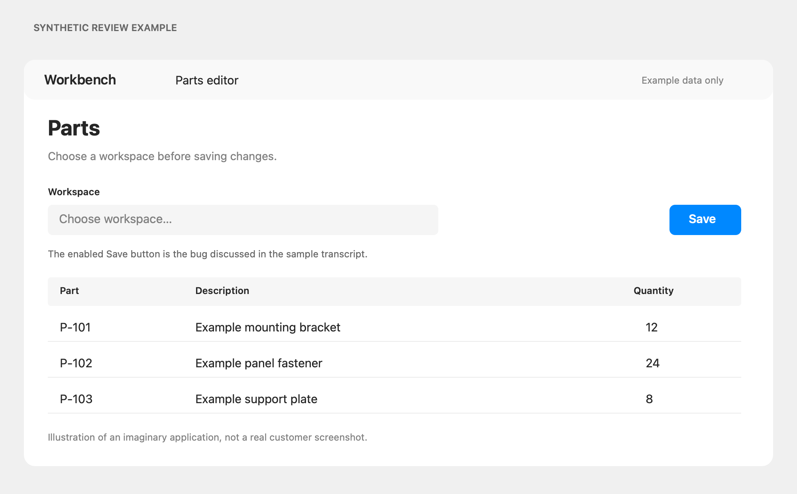

# Synthetic feedback session 2026-01-01 10:00

- Mode: call (Me = microphone, Them = system audio)
- Input: Demo microphone
- Started: 2026-01-01 10:00:00

[00:12] Them: The parts page takes ages to load when I open a workspace.
[00:20] Me: That is the cold start on the service.
[00:31] 
[00:34] Them: And this Save button should be disabled until a workspace is picked.
[08:40] Them: Also the other list is sorted wrong.
[12:05] (input changed to Demo headset)
[1:02:05] Them: Last thing, the export should include the supplier column.
